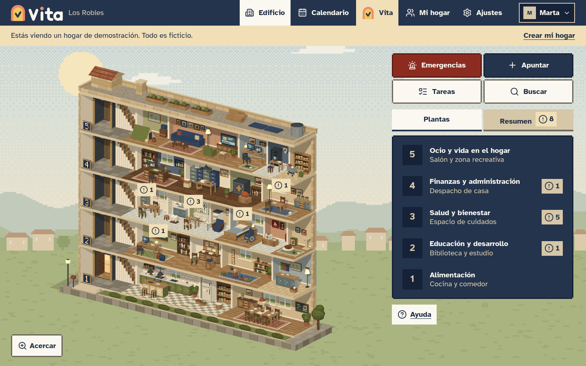
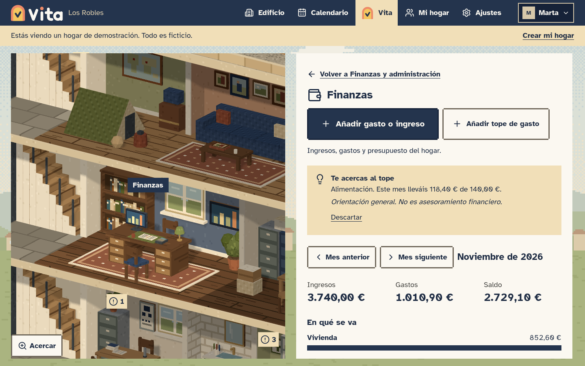
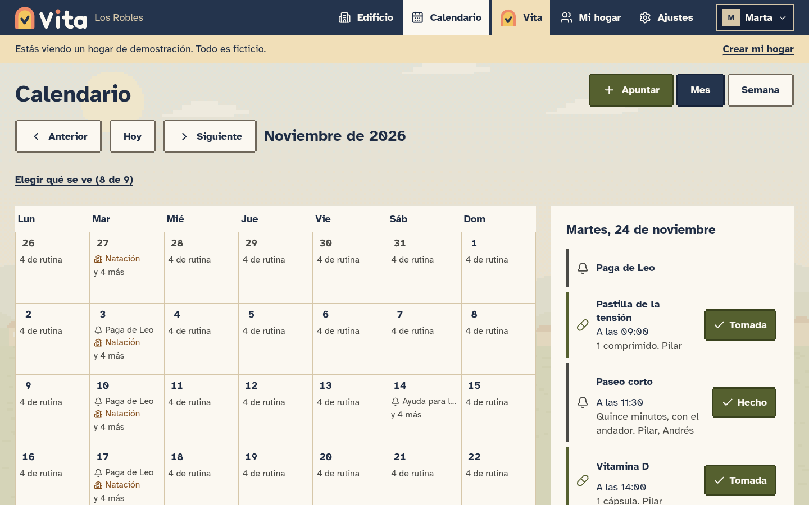
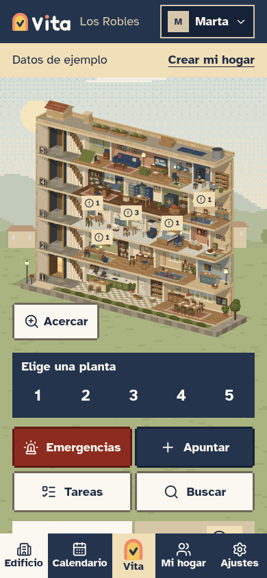
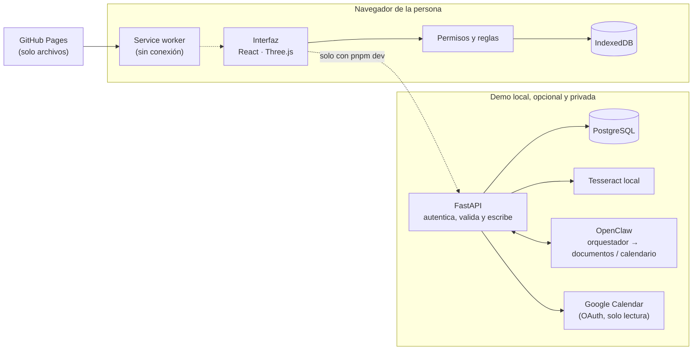
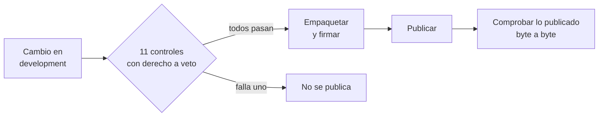

<div align="center">


# Vita

**La vida del hogar, en un edificio que se recorre con el dedo.**

Comidas, colegio, salud, cuentas y planes: cada cosa en su habitación, en tu propio dispositivo.

Vita también incluye un backend local y opcional para demostraciones: delega tareas a subagentes de OpenClaw, consulta Google Calendar en modo de solo lectura mediante OAuth y analiza imágenes ficticias con OCR local. Calendar solo consulta el calendario principal, con autorización explícita y un rango de hasta 31 días; no crea ni modifica eventos. **No uses documentos reales ni publiques la API o el Gateway de OpenClaw.**

[](https://github.com/TheBuilders1/Vita/actions/workflows/deploy.yml)


### [Abrir Vita](https://thebuilders1.github.io/Vita/)

[Qué hace](#qué-hace) · [Empezar](#empezar) · [Arquitectura](#arquitectura) · [Seguridad](#seguridad-y-privacidad) · [Despliegue](#calidad-y-despliegue) · [Documentación](#documentación)



</div>

## Por qué Vita

La información de una casa vive repartida: la cita en un papel, la garantía en un cajón, la medicación en la cabeza de alguien. Vita la reúne en un sitio que se entiende sin manual. Está pensada para personas de más de 40 años, con letra legible, botones grandes y lenguaje llano, y para hogares donde conviven edades y necesidades distintas.

Para probarla no hace falta registrarse: abre la web y elige **«Ver un hogar de ejemplo»**. Todos sus datos son ficticios.

## Qué hace

| Planta | Lugar | Qué guarda |
| :-: | --- | --- |
| **5** | Salón y zona recreativa | Planes, compras, tecnología segura y recuerdos |
| **4** | Despacho de casa | Gastos, presupuesto, ahorro, paga de los hijos y documentos |
| **3** | Espacio de cuidados | Citas, medicación, vacunas, cuidados y emergencias |
| **2** | Biblioteca y estudio | Colegio, becas, crecimiento y reservas de actividades |
| **1** | Cocina y comedor | Recetas, menús, necesidades de cada persona y nevera |

Además, en todo el edificio:

- **Calendario y tareas** que salen solos de lo apuntado, con tareas repetidas y exportación a otros calendarios (`.ics`).
- **Perfiles y permisos** por persona y por habitación, con una vista sencilla para quien la necesite.
- **Búsqueda** sin tildes, **papelera** de 30 días, deshacer e historial.
- **Copias de seguridad** completas, con contraseña opcional.
- **Sin conexión:** se instala como aplicación y funciona sin internet.
- **Accesible:** teclado, lectura en voz alta, letra grande, contraste alto y alternativa en 2D al edificio.

<table>
  <tr>
    <td width="50%"></td>
    <td width="50%"></td>
  </tr>
  <tr>
    <td align="center"><em>Una habitación por tema</em></td>
    <td align="center"><em>El día de todo el hogar</em></td>
  </tr>
</table>

<p align="center"></p>

## Empezar

Requiere Node 22.22 o superior y pnpm 12.

```bash
git clone https://github.com/TheBuilders1/Vita.git
cd Vita/frontend
pnpm install
pnpm dev
```

| Orden (en `frontend/`) | Qué hace |
| --- | --- |
| `pnpm dev` | Servidor de desarrollo |
| `pnpm check` | Linter, tipos, pruebas y compilación |
| `pnpm build && pnpm e2e` | Pruebas en navegador y de accesibilidad sobre la versión compilada |

La web funciona sola. El backend es opcional y se arranca aparte: ver [docs/backend.md](docs/backend.md).

El backend de demostración añade autenticación local, ejecución asíncrona con resultados validados, OAuth individual para Calendar con refresh tokens cifrados y OCR privado de imágenes ficticias. La persona confirma cualquier fecha antes de que se guarde un recordatorio. Consulta [docs/backend.md](docs/backend.md) para configuración, seguridad y ejemplos.

## Arquitectura



- **Frontend** ([`frontend/`](frontend/)): guarda todo en el navegador. Cada módulo se declara una vez y de ahí salen validación, formularios, listados y agenda.
- **Backend** ([`app/`](app/)): demo local para OCR y consultas de Google Calendar de solo lectura. Delega en agentes, pero la API es la única que autoriza, valida y escribe.
- **Agentes** ([`openclaw/`](openclaw/)): interpretan y delegan. No tienen acceso a la base de datos, a las imágenes ni a internet.

| Capa | Tecnología |
| --- | --- |
| Interfaz | React 19, TypeScript 7, Tailwind 4, React Router 8 |
| Edificio 3D | Three.js y React Three Fiber, con geometría y texturas propias |
| Datos en el navegador | Dexie (IndexedDB), Zod, Web Crypto |
| Backend | FastAPI, PostgreSQL 16, Tesseract, OpenClaw, Google Calendar API |
| Pruebas | Vitest, Playwright, axe, pytest |

## Seguridad y privacidad

La web publicada **no manda los datos del hogar a ningún servidor propio ni ajeno**, salvo el dictado remoto si alguien lo activa: no hay cuentas, analítica ni recursos de terceros, y la política de contenido impide que su código se conecte a otro sitio. La inteligencia artificial se trata como tráfico no confiable: la API comprueba cada resultado y una persona confirma antes de guardar un recordatorio.

Conviene saber sus límites:

- Los datos **no están cifrados** en el navegador y se pierden si se borra su almacenamiento. La copia de seguridad sí puede llevar contraseña.
- Los roles ordenan el uso en casa; no protegen frente a quien usa el mismo dispositivo.
- El dictado del navegador puede usar un servicio externo si se activa esa opción en Ajustes. Viene apagado.
- El backend es una demo con datos ficticios. **No uses documentos reales ni publiques la API o el Gateway.**

Para comunicar un fallo de seguridad: [SECURITY.md](.github/SECURITY.md).

## Calidad y despliegue

Cada cambio en `development` pasa once controles. Si falla uno, no se publica y sigue en pie la versión anterior.



Qué comprueba cada control, cómo cambiar la dirección, el modo mantenimiento y los principios de seguridad: [docs/despliegue.md](docs/despliegue.md).

## Documentación

| Documento | Contenido |
| --- | --- |
| [docs/backend.md](docs/backend.md) | Instalación, API, flujos de demostración y variables del backend |
| [docs/despliegue.md](docs/despliegue.md) | Publicación, controles y endurecimiento |
| [frontend/docs/arquitectura.md](frontend/docs/arquitectura.md) | Capas, reglas, edificio y decisiones del frontend |
| [frontend/docs/usabilidad.md](frontend/docs/usabilidad.md) | Usabilidad, accesibilidad y guion de pruebas con personas |
| [vita-backend.md](vita-backend.md) | Plan y decisiones del backend |

## Colaborar

Se trabaja sobre `development`. Los mensajes de commit siguen [Conventional Commits](https://www.conventionalcommits.org/es/v1.0.0/) y se comprueban en cada pull request.

```text
app/  migrations/  database/   backend y base de datos
openclaw/                      agentes y su plugin
frontend/                      aplicación web
tests/                         pruebas del backend
frontend/tests/                pruebas del frontend
tools/                         guardianes del repositorio y servidor de pruebas
.github/                       despliegue y plantillas
docs/                          documentación
```

---

<div align="center">

Hecho para el hackathon de Talent Land por [TheBuilders1](https://github.com/TheBuilders1).

</div>
